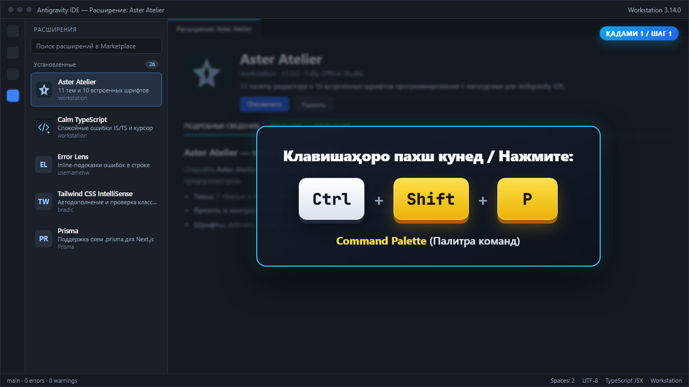
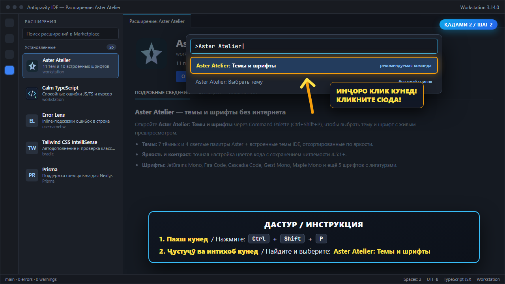
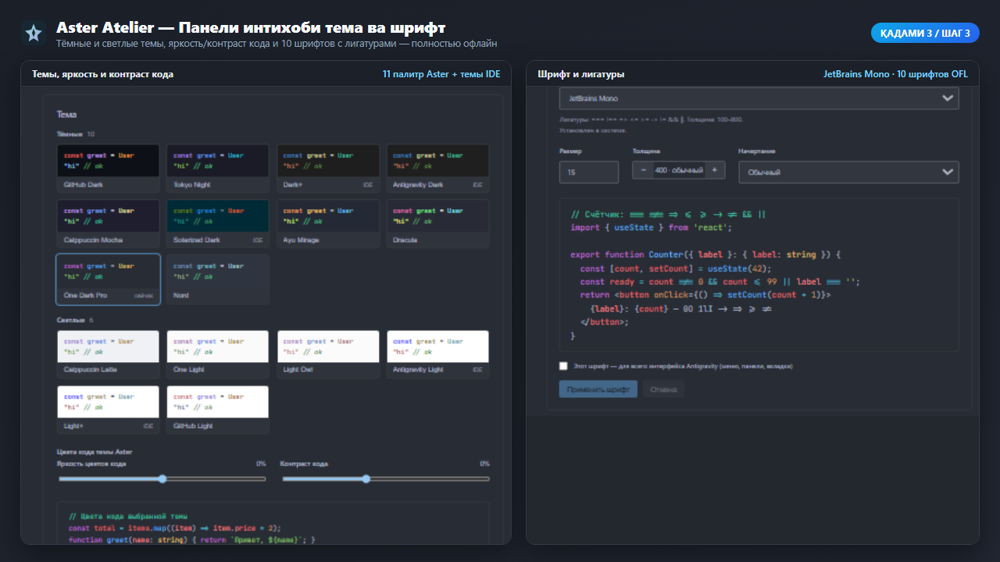

# Aster Atelier

Eleven editor palettes after the most used themes. Ten bundled programming fonts and seven font styles. One studio for all of them, fully offline: every theme and font ships inside the extension.

## Как открыть Aster Atelier / Чӣ хел кушодан

1. Нажмите **`Ctrl + Shift + P`** (**Клавишаҳоро пахш кунед**), чтобы открыть Command Palette.

2. Введите **`Aster Atelier`** и выберите **`Aster Atelier: Темы и шрифты`**.

3. Выберите тему, настройте яркость/контраст кода и выберите шрифт с лигатурами прямо в панели.

## Возможности студии

- **Theme** — every theme is a card drawn in its own colours, in two sections, **Тёмные** and **Светлые**. Aster palettes and the IDE's own themes (Antigravity Light/Dark, Dark+, Light+, Solarized Dark; marked «IDE») stand together, each section ordered from the darkest editor background to the brightest. A click on a card (or Enter on the focused card) selects it at once and applies the theme; quick clicks write only the newest choice. Arrow keys move between cards without applying; the page keeps its scroll position. A theme chosen elsewhere gets its own card at its place.
- **Code colours** — **Яркость цветов кода** and **Контраст кода** retune the code colours of an Aster palette. A code sample in the selected theme follows the sliders live; the editor changes with **Применить яркость и контраст**, and **Отмена** returns to the applied values.
- **Font** — family, size, weight and style are previewed in the panel, in the selected theme's colours and with ligatures, and applied together with **Применить шрифт**. The weight has its own − and + buttons that step through the weights the selected font really has; a style never changes the weight. Applying a font also switches on `editor.fontLigatures`. The family is set for the editor, terminal, debug console, chat, inlay hints, inline suggestions, notebooks and the commit message box. With **Этот шрифт — для всего интерфейса** the menus, side bar, tabs and panels use it too, within a second and without a restart; unchecking it brings the IDE's own font back. Icons, the editor and the terminal keep their own fonts.

**Aster Atelier: Выбрать тему** is a quick list with the same two sections that applies only on click or Enter.

Aster palettes are applied over the plain Visual Studio Light/Dark theme as theme-scoped colours, so they are not listed in the IDE's own theme picker (which changes the theme while you hover). A theme switch writes only the settings that change, the colours before the base theme, so a switch between a dark and a light palette shows one finished repaint. Every part of the window is coloured — editor, side bar, panels, tabs, menus, widgets, notifications, terminal, diff, chat and syntax. All palettes colour the same 22 code roles (keywords, declarations, function and method calls, variables, parameters, properties, types, JSX tags and attributes, imports, strings, template strings, constants, regex, operators, punctuation, comments, doc comments) with semantic highlighting on; every code colour reads at 4.5:1 or more and comments at 5:1. Comments are a clear green that suits the palette — green, or sea green or teal where the palette's strings are green already — never grey. Squiggles and Error Lens messages are visible but calm (error 70 %, warning 55 %, info 45 %, hint 35 % opacity), and Error Lens draws no backgrounds. Colours you set yourself in `workbench.colorCustomizations` keep winning.

All ten fonts ship inside the extension (SIL Open Font License, SHA-256 pinned) and are installed once per font version for the current OS user, without a download. A newly installed font appears in the editor after a full IDE restart; the notice about it is shown once. A font removed from Aster stays installed and keeps working; the studio lists it by its own name.

## Palettes

**Dark:** GitHub Dark · Tokyo Night · Catppuccin Mocha · Ayu Mirage · Dracula · One Dark Pro (default) · Nord

**Light:** Catppuccin Latte · One Light · Light Owl · GitHub Light

Each palette keeps the hues of the theme it follows — sources, licences and the colour rules are in [THEMES.md](THEMES.md).

## Fonts

| Font | Coding ligatures | Cyrillic | Weights |
| --- | --- | --- | --- |
| JetBrains Mono (default) | all: `=> === !== && \|\| <= >= -> !=` | yes | 100–800 |
| Fira Code | all | yes | 300–700 (no italic face) |
| Cascadia Code | all | yes | 200–700 |
| Victor Mono | all but `\|\|` | yes | 100–700 |
| Monaspace Krypton Var | all (stylistic sets on) | yes | 200–800 |
| Iosevka | all but `&&` | yes | 400 (Regular and Italic; bold is drawn by the renderer) |
| IBM Plex Mono | **none** — operators are drawn as separate characters | yes | 300–700 |
| Geist Mono | all but `&&` and `\|\|` | yes | 100–900 |
| Rec Mono Linear (Recursive for code) | all | no — Russian text uses a fallback font | 400, 700 |
| Maple Mono | all | yes | 100–800 |

**Styles:** Normal · Italic · Italic comments · Italic keywords · Italic comments and keywords · Bold keywords · Bold declarations (functions, methods, classes, interfaces, types). A style never changes the weight; operators such as `=>` `===` `&&` stay upright and regular. Existing personal colours and token rules are retained.

Часть профиля [Antigravity Workstation](https://github.com/m-safarov/antigravity-workstation#quick-start).
