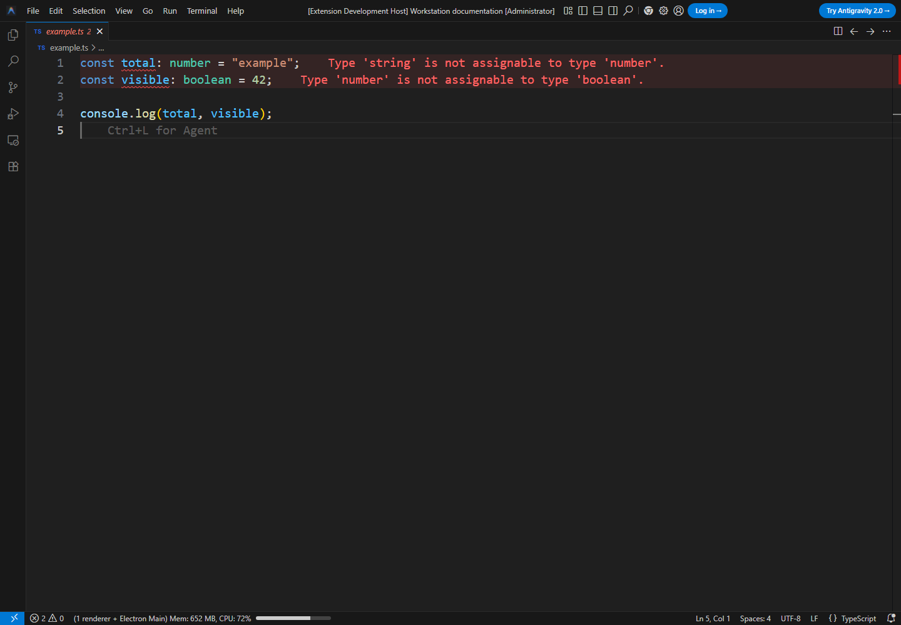
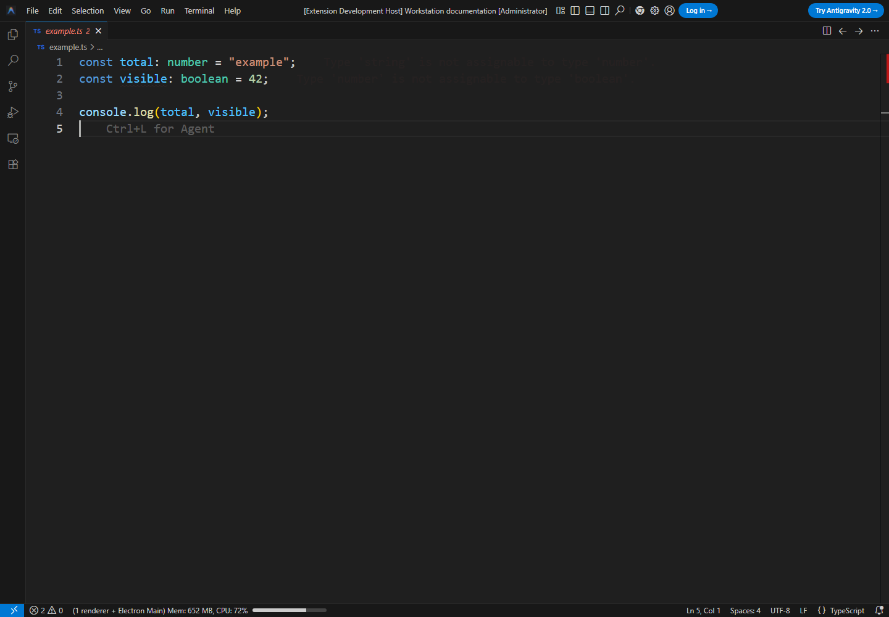

# Calm TypeScript

Спокойные, но хорошо читаемые диагностики JavaScript и TypeScript (React, Next.js и Node.js): ошибки остаются видимыми (~70% непрозрачности), предупреждения — 55%, подсказки — 45% и 35%, без сплошных цветных полос фона от Error Lens. Проверка типов TypeScript, панель Problems и обычный IntelliSense работают полностью.

Курсор плавный (`editor.cursorSmoothCaretAnimation: on`, ширина 2 px); после ручного **Ctrl+S** строка мягко подсвечивается. Расширение само не сохраняет файлы — автосохранением управляет IDE (`files.autoSave: afterDelay`), чтобы код не переформатировался во время набора.

## До и после (`calmTypeScript.quietMode`)

Оба снимка сделаны в одной сессии Antigravity IDE на одном файле `example.ts`, теме и масштабе — переключается только `calmTypeScript.quietMode`. Обе ошибки TypeScript (`⊗ 2`) остаются на месте.

| До (`quietMode: false`) — сплошной фон Error Lens | После (`quietMode: true`) — спокойная диагностика без фоновых блоков |
| --- | --- |
|  |  |

## Настройки и сброс

- Настройки: **Settings → Extensions → Calm TypeScript** (`quietMode`, `smoothTyping`, `typingPulse`, `savePulse`).
- Команда сброса: **Command Palette → `Calm TypeScript: Reset Managed Editor Settings`** — возвращает значения, сохранённые при первой активации расширения.

Расширение входит в [Antigravity Workstation](https://github.com/m-safarov/antigravity-workstation#quick-start) и хранит все изображения офлайн внутри VSIX.
