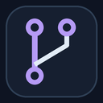

# Git Branch Panel

Две панели в **Explorer**: **GitHub** (командная работа с Git и GitHub) и **npm-скрипты**.

Панель **GitHub** работает с тем же `git`, что и Git Bash. Команды, изменяющие репозиторий, выполняются прозрачно в терминале **GitHub** (Git Bash) с защитой от зависаний и автоматическим переходом на фоновое выполнение, если терминал не поддерживает shell integration.

## Основные возможности (1.9.3)

### Состояние репозитория и обновление
- Вверху отображаются имя репозитория, текущая локальная ветка, точный настроенный `upstream` (например `origin/main` или `upstream/release`) и направление счётчиков (`↓` входящие / `↑` исходящие).
- Кнопка обновления (**↻**) выполняет `git fetch --prune`, отражает добавленные, удалённые и переименованные ветки, корректно работает с несколькими remotes и detached HEAD, и отбрасывает устаревшие асинхронные ответы, чтобы старый запрос никогда не перетёр новое состояние. Черновики и выбранные галочки сохраняются.

### Commit и подсказка сообщения по Tab
- Отметь нужные файлы (секретные файлы вроде `.env`, `.pem`, `.key` блокируются до индексации), напиши сообщение и нажми **Commit** — после commit панель подтверждает, что commit реально создан в `HEAD`.
- **Одна подсказка commit по `Tab`:** панель анализирует реальный diff выбранных файлов (без секретов и без выдуманных правок) — через локальный ИИ (`Workstation Stability` с ключом в `SecretStorage` или личном `%USERPROFILE%\.gemini\config\workstation-setup\.env` вне Git), либо через встроенный локальный генератор. Когда поле пустое, нажатие `Tab` вставляет редактируемый текст в поле (никогда не делает авто-commit и авто-push); если текст уже набран или подсказки нет, `Tab` работает как обычная навигация.

### Push, Pull и Получить изменения
- Перед нажатием всегда показаны точный источник и назначение (`Push: branch → remote/branch`, `Pull: remote/branch → branch`); в списке выбора источника для Pull отображаются ветки всех настроенных remotes (`origin`, `upstream` и т.д.).
- **Pull** по умолчанию использует настроенный `upstream`, сначала выполняет `fetch`, безопасно обрабатывает fast-forward, расхождение веток, конфликты (выбор «Моё» / «Из GitHub» или «Отменить merge»), удалённую ветку на сервере и несохранённые изменения.
- **Push** никогда не делает `--force`; при первой отправке настраивает `upstream` (`-u`).

### Pull Request
- Выбираемые вручную ветки **`head`** (источник) и **`base`** (целевая ветка) — панель никогда не подменяет `base` на `main` скрытно.
- Перед отправкой проверяются подключение к GitHub, наличие веток на сервере, наличие commits ahead и уже открытый PR; после создания отображаются номер PR и ссылка.

### Удаление веток с выбором области
- Выбор области: **Локально и в GitHub**, **Только локально** или **Только в GitHub**.
- Показывает точный репозиторий, remote и ветку перед подтверждением; проверяет права и branch protection на сервере GitHub, проверяет открытые Git worktrees, защищает основную ветку, создаёт резервный ref (`refs/workstation-backup/…`) для unmerged commits и при удалении «в обоих местах» честно сообщает о частичном результате, если одна из сторон не удалилась.

### Автор commit и подпись расширения
- Автор commit — тот, кто его делает: аккаунт GitHub, в который выполнен вход в редакторе, с его приватным адресом `…@users.noreply.github.com` (GitHub показывает профиль и аватар, личная почта не публикуется). Владелец репозитория — автор только когда в редакторе вошёл он сам; collaborator делает commits от своего аккаунта и никогда не записывается владельцем. Без входа — тот, кто входил в этом проекте раньше, иначе локальный `git config` (`user.name` / `user.email`). Глобальный `git config` не меняется.
- Верхняя строка показывает, чьё имя получит следующий commit. Если в GitHub имя автора серое и без аватара, почта этого commit не добавлена в аккаунт GitHub ([github.com/settings/emails](https://github.com/settings/emails)): войди в GitHub в редакторе или добавь эту почту в аккаунт.
- Внизу панели отдельно указана компактная подпись расширения **Antigravity Workstation (m-safarov)** — она не связана с автором Git commits и аккаунтом GitHub.

### npm-скрипты
Скрипты из `package.json` (`dev`, `start`, `build`, `lint`, `test` и др.) запускаются одним щелчком в терминале Git Bash с кнопками остановки, перезапуска и открытия локального URL сервера.

Часть [Antigravity Workstation](https://github.com/m-safarov/antigravity-workstation#quick-start).
